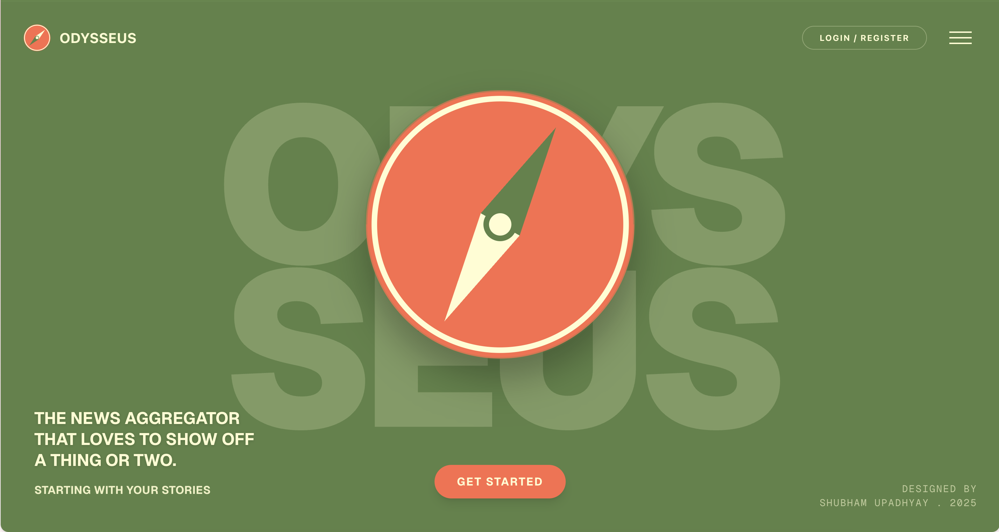
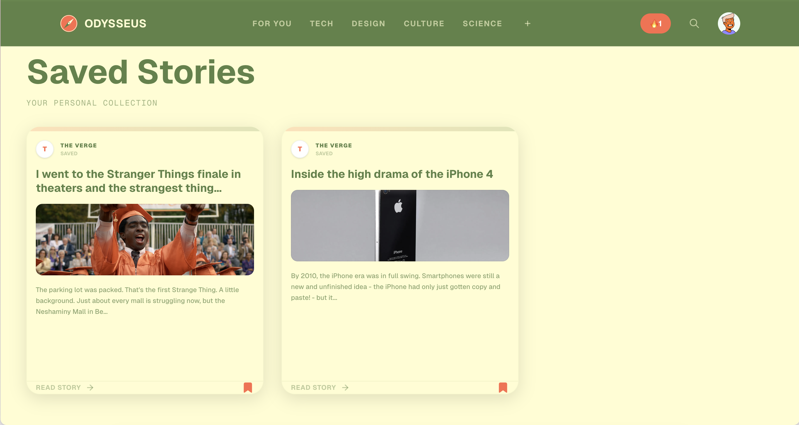
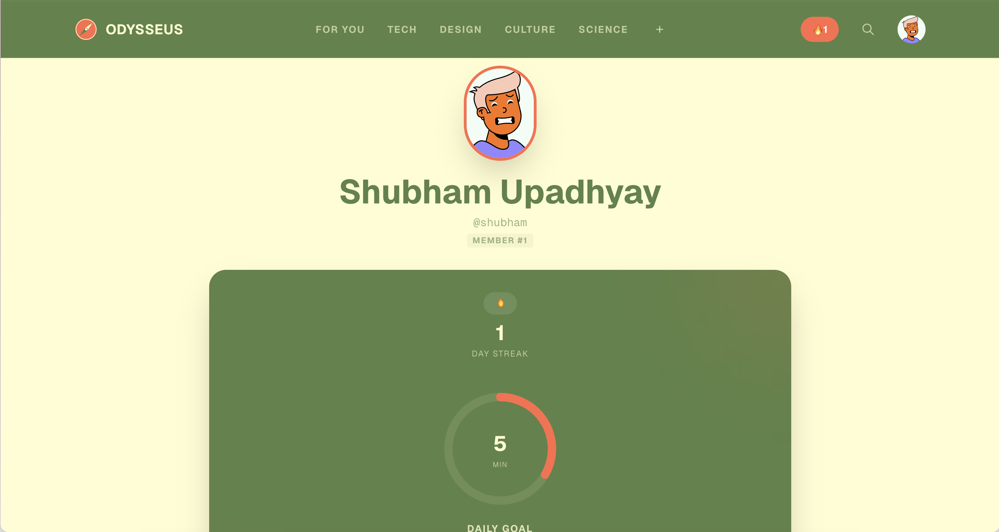

<div align="center">

  

  # ODYSSEUS
  ### *The Living Book Salon & Slow-Journalism Broadsheet*

  <p align="center">
    <strong>An ultra-premium, bookish editorial broadside designed for intellectual curiosity, deep reading, and distraction-free prose.</strong>
  </p>

  <p align="center">
    
    
    
    
    
    
  </p>

  <p align="center">
    <a href="#-the-odysseus-philosophy">Philosophy</a> •
    <a href="#-the-living-book-aesthetic--curated-desks">Living Book & 5 Desks</a> •
    <a href="#-backend-pipeline--image-proxy-engine">Backend & Image Proxy</a> •
    <a href="#-feature-showcase-deep-dive">Feature Showcase</a> •
    <a href="#-the-odyssey-chrome-companion">Odyssey Companion Extension</a> •
    <a href="#-reading-chamber--zen-interface">Zen Chamber</a> •
    <a href="#-gamification--the-travelers-passport">Gamification & Ledger</a> •
    <a href="#-architecture--tech-stack">Tech Stack</a>
  </p>

</div>

---

## ✦ The Odysseus Philosophy

The modern web is inundated with algorithmic rage-bait, aggressive newsletter popups, intrusive cookie walls, auto-playing video sidebars, and cluttered clickbait. Reading thoughtful, slow journalism has become an obstacle course.

**Odysseus is our antidote.**

Built as a **tactile, ultra-premium living book**, Odysseus merges the physical tactility of independent prestige print broadsides (*The New Yorker*, *The Paris Review*, *Monocle*, *Wired*, *Bloomberg Markets*) with cutting-edge web performance:
- **Zero Noise**: No author bylines, author bios, social follow cards, newsletter subscription boxes, or tracking pixels inside your articles. Pure narrative prose only.
- **Living Book Editorial Palette**: Architectural warm parchment (`#FAF7F0` / `#F5F2EB`), pressroom forest green (`#243624` / `#5D8246`), cadmium orange accents (`#FF6B4A`), and deckle edge rules.
- **Strict Typographic Glyph Discipline**: Zero emojis throughout all editorial interfaces. Replaced by timeless glyphs (`✦`, `◈`, `◆`, `❖`, `⬡`, `—`) and bespoke SVG vector monograms.
- **Resilient Media Architecture**: Backed by an Edge Image Proxy and vector `EditorialMonogramPoster` fallback engine that guarantees zero broken cards or missing thumbnails across all feeds.
- **Mindful Habit Cultivation**: Daily reading rhythm rewarded through quiet contemplation multipliers, explorer rank elevations, streak freeze shields, and a weekly print habit ledger.

---

## ❖ The Living Book Aesthetic & The 5 Curated Desks

Odysseus organizes global slow journalism across 5 prestigious editorial desks, styled like an architectural anthology:

1. **The Vanguard (`/feed/tech`)** — `◈`
   - *Domain*: Frontier computation, artificial minds, edge cryptography & digital craft.
   - *Sources*: TechCrunch, The Verge, Wired, Ars Technica, Hacker News.
2. **The Atelier (`/feed/design`)** — `◆`
   - *Domain*: Typographic discipline, visual ergonomics, physical architecture & interactive form.
   - *Sources*: Smashing Magazine, UX Collective, A List Apart, Dezeen, It's Nice That.
3. **The Forum (`/feed/culture`)** — `✦`
   - *Domain*: Contemporary criticism, transatlantic essays, philosophy & human affairs.
   - *Sources*: The Atlantic, The New Yorker, Paris Review, Harper's Magazine, The Dial.
4. **The Chronicle (`/feed/chronicle`)** — `❖`
   - *Domain*: Global finance, macroeconomic architecture, institutional statecraft & markets.
   - *Sources*: Bloomberg, Financial Times, The Wall Street Journal, Reuters, The Economist.
5. **The Observatory (`/feed/science`)** — `⬡`
   - *Domain*: Fundamental astrophysics, cosmic expeditions, quantum physics & biological frontiers.
   - *Sources*: Scientific American, Nature, Quanta Magazine, NASA Dispatches, MIT Tech Review.

---

## ◈ Backend Pipeline & Image Proxy Engine

On modern serverless platforms like Vercel, traditional RSS scrapers routinely fail due to 10-second edge timeouts and publisher anti-hotlinking defenses. Odysseus solves this with a **4-tier media resiliency architecture**:

1. **Anti-Hotlinking Edge Proxy (`/api/image-proxy`)**:
   - Bypasses HTTP 403 Forbidden restrictions enforced by prestige publishers (NYT, Bloomberg, Wired) by injecting dynamic `Referer: ${origin}/` and user-agent headers.
   - Streams optimized binary images with 7-day immutable edge caching (`Cache-Control: public, s-maxage=604800, stale-while-revalidate=86400`).
2. **Throttled Ingestion & XML Parsing (`/api/rss`)**:
   - Extracts images across all RSS variants: `<media:content>`, `<media:thumbnail>`, `<enclosure>`, and `<media:group>`.
   - Validates MIME types to prevent podcast/audio MP3s from being parsed as article artwork.
   - Limits concurrent OpenGraph HTML scrapes to 4 per feed, eliminating Vercel serverless timeouts.
3. **Automatic Client-Side Proxy Retry**:
   - When an image fails to load on a reader's browser, `StoryCard` and `SavedStoryCard` immediately attempt fallback retrieval via the edge proxy.
4. **Editorial Monogram Poster Engine (`EditorialMonogramPoster.tsx`)**:
   - If a story lacks artwork or if publisher CDNs are unavailable, cards automatically render a bespoke SVG collector's print featuring the publication's monogram, architectural coordinate lines, category glyph, and deckle frame. **100% card presentation coverage is guaranteed.**

---

## ✦ Feature Showcase (Deep-Dive)

### 1. Instapaper & Pocket-Style Pure Prose Purification Engine
Odysseus does not simply scrape a web page and dump noisy HTML. It features an aggressive content isolation and purification pipeline:
- **Author Byline & Bio Purging**: Strips all `By [Author]`, contributor cards, author headshots, and social follow cards. You receive only the story.
- **Web Cruft Removal**: Purges newsletter signup forms, Substack subscription embeds, cookie banners, navigation breadcrumbs, related article link farms, and ad sidebars.
- **Universal Import**: 
  - Paste any URL from Medium, Substack, Bloomberg, The Verge, or personal blogs into the header navbar, the `/feed` hero spread, or the `/saved` offline salon.
  - Instantly sanitizes the HTML, computes estimated reading time, and lets you either **Read In Zen Chamber** or **Save to Offline Salon**.

---

### 2. The Odyssey Chromium Companion Extension (Manifest V3)
A standalone Chrome/Chromium companion extension located in [`/extension`](extension/) that turns your entire browser into an Odysseus feeder:
- **1-Click Save**: Click the orange compass icon on your toolbar or press `Alt + Shift + S` (`Cmd + Shift + S` on Mac) to save the current page immediately.
- **In-Page Luxury Toast Notification**: A floating cream-and-orange magazine toast appears on the webpage confirming your save with a direct link: `Read in Zen Chamber →`.
- **Right-Click Context Menu**:
  - `✦ Save Story to Odysseus Salon`
  - `✦ Read Now in Zen Chamber ↗`
  - `✦ Save Highlight to Odysseus Notebook` (on selected text)
- **High-Fashion Popup Interface**: Inspects the active tab's domain, article title, estimated read time, and displays your recent saves history.
- **Live Sync**: Works with your live Vercel deployment (`https://odysseus.vercel.app`) or local development (`http://localhost:3000`).

---

### 3. The Zen Chamber Reading Interface & Reading Progress
Reading inside Odysseus is designed to feel like an evening in a private library:
- **Clean Reading Progress Indicator**:
  - **Header Meter**: Elegant slim reading progress indicator tracking exact percentage down the story.
  - **Floating Tactical HUD**: A tactile floating pill that shows live percentage read, elapsed minutes, and celebratory stamp (`Completed ✦`) upon finishing the article. Clicking the HUD smoothly scrolls back to the top of the story.
- **Typography & Theme Switcher**:
  - **Zen Night** (`#0f1117`), **Parchment Sepia** (`#f4ecd8`), and **Gallery Light** (`#ffffff`).
  - Fluid font sizing (`A-` / `A+`) and typography with generous line heights and pull quotes.
- **Speech Synthesis (TTS Read Aloud)**:
  - Built-in text-to-speech player controls allowing you to listen to any purified article hands-free.

---

### 4. Gamification Engine & The Traveler's Passport
Odysseus turns reading into a mindful, rewarding habit without gimmicks:
- **Time-of-Day Multipliers**:
  - ✦ **Early Bird Boost (1.5x)**: Active 6:00 AM – 9:00 AM for mindful morning readers.
  - ◆ **Night Owl Salon (1.5x)**: Active 10:00 PM – 2:00 AM for late-night scholars.
  - ◈ **Weekend Explorer (1.25x)**: Active all day Saturday & Sunday.
- **5 Explorer Ranks**:
  1. `Novice Wanderer` (0 – 60 mins read)
  2. `Wayfarer` (60 – 240 mins read)
  3. `Cartographer` (240 – 600 mins read)
  4. `Odyssey Vanguard` (600 – 1,200 mins read)
  5. `Grand Odyssey Master` (1,200+ mins read)
- **Streak Shield Vault**: Dual-slot freeze vault holding streak freeze shields (`◈`) that automatically protect your streak when traveling or offline.
- **Interactive 7-Day Habit Ledger**: Weekly spread tracking daily read times with wax seal completion stamps (`✓`).
- **Hall of Odyssey Medals (8 Unlockable Achievements)**:
  - *Inaugural Voyage* (First read)
  - *Dawn Patrol* (Early morning session)
  - *Midnight Scholar* (Late night read)
  - *Centurion Reader* (100+ lifetime minutes)
  - *Streak Sentinel* (7-day uninterrupted streak)
  - *Grand Archivist* (5+ saved stories)
  - *The Polymath* (Reading across all 4 publication desks)
  - *Grand Odyssey Master* (Pinnacle Rank 5)

---

### 5. 🗺️ The Curated Editorial Spreads

#### A. The Main Feed (`/feed`)
- **Editorial Masthead Dateline**: Volume number, date, edition label, and global salon indicator.
- **Interactive Spinning Compass**: Central 3D-styled interactive compass surrounded by celestial orbit rings and kinetic watermark typography.
- **Live Traveler Status Ribbon**: Displays your active multiplier badge, day streak counter, shield status, and explorer rank.
- **Breaking News Ticker & Quick Portals**: Jump straight to the Cover Story, The Collection, or open the Import URL modal.

#### B. The Offline Salon (`/saved`)
- **Pocket & Instapaper Quick Bar**: Inline URL input allowing one-click purification and immediate chamber reading.
- **Filter Desks**: Filter between `All Saved`, `✦ Imported Web Prose`, and `Prestige Publications`.
- **High-Fashion Article Cards**: Saturated category tags, read time & word count badges, wax seal un-save buttons, and a **"Read in Chamber →"** trigger.

#### C. The Traveler's Ledger & Passport (`/profile`)
- **Passport Identity**: User avatar with golden orbit ring, verified wax seal badge, and live explorer rank.
- **4 Saturated Metric Spreads**:
  - Juice Orange Streak card with active flame animation.
  - Deep Forest Green Daily Pace Dial with circular SVG gauge.
  - Warm Amber Milestone Perk card with progress bar.
  - Ice Blue Streak Freeze Vault holding active shields.
- **Interactive Daily Commitment Slider**: Calibrate your daily reading goal from 5 to 60 minutes with instant database sync.

#### D. The Configuration Atelier (`/settings`)
- **Reading Cadence Card**: Calibrate daily goals (`10m`, `15m`, `30m`, `45m`).
- **Prose Isolation Protocol**: Toggles for aggressive noise filters and multiplier hour notifications.
- **Visual Chamber Themes**: Choose default lighting environments (*Zen Night*, *Parchment*, *Gallery*).
- **Curated Publication Desks**: Toggle subscriptions to *The Vanguard*, *The Atelier*, *The Forum*, *The Chronicle*, and *The Observatory*.

#### E. Genre Desks (`/feed/[category]`)
- Distinct broadside layouts for **Tech**, **Design**, **Culture**, and **Science**.
- Native CSS scroll-snapping (`snap-y snap-mandatory`) coordinated with Lenis smooth scrolling.
- Publication filter pills and dynamic header color synchronization.

---

## 📸 Gallery & Interface Highlights

### The Editorial Broadside Hero

<p align="center"><em>Central interactive compass, kinetic watermark typography, and traveler status ribbon.</em></p>

### The For You Feed & Broadside Spread

<p align="center"><em>Curated slow journalism feeds styled as a physical broadside publication.</em></p>

### The Zen Chamber Reader

<p align="center"><em>Pure narrative prose with zero noise, custom typography, and the radial progress scroll wheel.</em></p>

### The Saved Salon & Pocket-Style Library

<p align="center"><em>Offline repository of bookmarked stories and custom imported web articles.</em></p>

### The Traveler's Ledger & Passport

<p align="center"><em>Comprehensive reading analytics, streak multipliers, weekly habit ledger, and achievement medals.</em></p>

---

## 🛠 Architecture & Tech Stack

Odysseus is engineered for zero-latency interactions and bulletproof reliability:

```
                          ┌──────────────────────────┐
                          │   Odyssey Chrome Ext     │
                          │      (Manifest V3)       │
                          └────────────┬─────────────┘
                                       │ 1-Click Import
                                       ▼
┌────────────────────────────────────────────────────────────────────────┐
│                        ODYSSEUS WEB APPLICATION                        │
│                                                                        │
│   Next.js 16 (App Router + Turbopack)  •  React 19  •  TypeScript      │
│   Tailwind CSS v4 (Juice Theme)        •  GSAP Kinetic Engine          │
│   Lenis Smooth Scroll                  •  Mozilla Readability          │
│   DOMPurify Prose Sanitizer            •  SimHash Clustering           │
└──────────────────────────────────┬─────────────────────────────────────┘
                                   │
                                   ▼
┌────────────────────────────────────────────────────────────────────────┐
│                        SUPABASE CLOUD PLATFORM                         │
│   PostgreSQL  •  Row Level Security (RLS)  •  Supabase Auth            │
└────────────────────────────────────────────────────────────────────────┘
```

| Layer | Technologies |
|---|---|
| **Core Framework** | **Next.js 16** (App Router, Turbopack, React 19) |
| **Language** | **TypeScript 5.0** (Strict Mode) |
| **Design Tokens & Palette** | **Tailwind CSS v4** (Living Book: `#FAF7F0`, `#243624`, `#FF6B4A`) |
| **Media & Proxy Engine** | **Edge Image Proxy** (`/api/image-proxy`) with Referer injection & Vector Monograms |
| **Kinetic Animations** | **GSAP 3.15**, **@gsap/react**, **Framer Motion 12** |
| **Scrolling Engine** | **Lenis 1.3** paired with native CSS scroll-snapping (`data-lenis-prevent`) |
| **Content Purification** | **Mozilla Readability**, **isomorphic-dompurify**, JSDOM heuristics |
| **Database & Auth** | **Supabase** (PostgreSQL, Row Level Security, Session Auth) |
| **Browser Extension** | **Chromium Manifest V3** (Service Worker, In-Page Toast, Storage Sync) |
| **Production Hosting** | **Vercel Edge Network** |

---

## ✦ Repository Structure

```bash
Odysseus/
├── extension/                 # ✦ The Odyssey Chromium Companion Extension
│   ├── manifest.json          # Manifest V3 configuration & permissions
│   ├── background.js          # Ephemeral service worker & context menus
│   ├── content.js             # In-page toast notification script
│   ├── content.css            # Luxury toast notification styling
│   ├── popup/                 # High-fashion popup UI (HTML/CSS/JS)
│   ├── options/               # Preferences & instance URL configuration
│   ├── icons/                 # 16px, 32px, 48px, 128px compass medallions
│   └── README.md              # 10-second installation guide for Chrome/Brave/Arc
├── public/                    # Static assets, logos, and screenshots
├── src/
│   ├── app/
│   │   ├── api/
│   │   │   ├── image-proxy/   # ✦ Edge image proxy with anti-hotlinking bypass & edge cache
│   │   │   ├── read-mode/     # Pure prose extraction & sanitation endpoint
│   │   │   ├── read-later/    # Saved articles sync API
│   │   │   └── rss/           # Multi-source RSS feed fetcher with XML parsers & OG throttler
│   │   ├── feed/              # The Main Living Book Broadsheet Feed & Hero spread
│   │   │   └── [category]/    # The 5 Prestige Desks (Vanguard, Atelier, Forum, Chronicle, Observatory)
│   │   ├── saved/             # The Offline Salon with Pocket/Instapaper quick purifier
│   │   ├── profile/           # The Traveler's Dossier & Grand Odyssey Passport
│   │   ├── settings/          # Configuration Atelier
│   │   └── layout.tsx         # Root layout with fonts and metadata
│   ├── components/
│   │   ├── AppHeader.tsx      # Sticky magazine navbar & Traveler's Chamber HUD
│   │   ├── ReadingModal.tsx   # Zen Chamber reader with progress indicator & HUD dial
│   │   ├── EditorialMonogramPoster.tsx # ✦ Bespoke SVG graphic typography & monogram fallback
│   │   ├── ImportArticleModal.tsx # Universal URL purification modal
│   │   ├── OnboardingModal.tsx # 4-step cinematic traveler calibration
│   │   └── StoryCard.tsx      # Living book broadside cards with proxy retry & monogram fallback
│   ├── data/
│   │   └── prestigeSources.ts # 100+ publication directory across 5 desks
│   ├── hooks/                 # Custom React hooks (useProfile, useSavedStories, useFeedFetcher)
│   └── lib/
│       ├── cleanArticleExtraction.ts # Instapaper/Pocket purification engine
│       ├── gamification.ts    # Multipliers, explorer ranks, and streak ledger
│       └── supabaseClient.ts  # Typed Supabase client
└── CHROMEWEBSTORE.md          # Chrome Web Store listing & permissions doc
```

---

## ✦ Getting Started

Follow these steps to run the complete Odysseus salon locally on your machine.

### Prerequisites
- **Node.js**: v18.18 or higher (v20+ recommended)
- **Package Manager**: `npm` or `pnpm`
- **Supabase Account**: A free Supabase project for Auth & PostgreSQL storage

### 1. Clone & Install
```bash
git clone https://github.com/Shubham126710/ODYSSEUS.git
cd ODYSSEUS
npm install
```

### 2. Configure Environment Variables
Create a `.env.local` file in the root directory:
```env
NEXT_PUBLIC_SUPABASE_URL="https://your-project.supabase.co"
NEXT_PUBLIC_SUPABASE_ANON_KEY="your-anon-key"
```

### 3. Launch Development Server
```bash
npm run dev
```
Open [http://localhost:3000](http://localhost:3000) in your browser to experience Odysseus.

### 4. Load the Odyssey Chrome Extension (Optional)
1. Open Google Chrome, Arc, Brave, or Edge and go to `chrome://extensions/`.
2. Turn on **Developer mode** (top-right toggle).
3. Click **Load unpacked** (top-left button).
4. Select the `extension/` directory from this repository.
5. The orange compass icon `✦` will appear in your browser toolbar ready to import any webpage!

---

## 🚢 Deployment

Odysseus is optimized for zero-config deployment on Vercel:

```bash
npm run build
```

1. Push your changes to the `main` branch on GitHub.
2. Connect your repository to [Vercel](https://vercel.com).
3. Add `NEXT_PUBLIC_SUPABASE_URL` and `NEXT_PUBLIC_SUPABASE_ANON_KEY` to your Vercel Project Environment Variables.
4. Deploy! Automatic CI/CD builds will deploy your updates in under 60 seconds.

---

## 📄 License & Credits

This project is licensed under the **MIT License** — feel free to explore, customize, and build upon it.

<div align="center">
  <sub>Curated & Crafted with devotion by <strong>Shubham Upadhyay</strong></sub>
  <br />
  <sub>✦ <em>Slow down. Read deeply. Explore fearlessly.</em> ✦</sub>
</div>
